# POPO LIVE — MASTER BUILD PLAN & WORKFLOW BLUEPRINT
> **Document Version:** 1.0  
> **Source Blueprint:** Popo Live Client Pack Confidential (7 November 2026)  
> **Status:** Active — Locked for Development  
> **Execution Rule:** Sequential (Phases 1 to 10 must be built in order; do not skip phases).

---

## 1. Executive Summary & Product Scope

**Popo Live** is a full-featured live streaming social entertainment platform consisting of:
- **Android App:** Full product: live streaming, party rooms, gifts, direct chat, user wallet.
- **iOS App:** Identical features to Android, built from a single Flutter codebase.
- **Web App:** Watch live streams, participate in party rooms, send messages, manage profiles, top-up coins.
- **Marketing Website:** Home landing page, news/blog, agency enrollment, policies/legal, app downloads.
- **Admin Panel:** User management, real-time live monitoring, gift management, payout operations, and reporting.

### Core Architecture Rule
> [!IMPORTANT]
> **One Unified Backend For All Platforms:**  
> All platforms (Android, iOS, Web, and Admin) share **one** backend, **one** central wallet ledger, and **one** global ban list. Never build separated backend silos.

---

## 2. Technology Stack (Locked for Start)

| Domain | Technology Choice | Details |
| :--- | :--- | :--- |
| **Mobile Apps** | **Flutter (Dart)** | Single codebase for Android & iOS |
| **Website & Web App** | **Next.js (React + TypeScript)** | SSR / SSG for SEO + Rich interactive web client |
| **Backend API** | **NestJS (Node.js + TypeScript)** | Modular, enterprise-grade architecture |
| **Database** | **PostgreSQL + Redis** | Relational data + High-speed caching & Pub/Sub |
| **Media & File Storage** | **S3-compatible object storage** | MinIO / AWS S3 / Cloudflare R2 |
| **Live Video & Voice** | **Agora RTC / RTM SDK** | Ultra-low latency interactive live streaming & 9-seat audio/video rooms |
| **Push Notifications** | **Firebase Cloud Messaging (FCM) + Apple APNs** | Cross-platform instant push alerts |

---

## 3. Product Decisions & Business Rules (Locked)

| Decision Key | Configured Value | Description / Rule |
| :--- | :--- | :--- |
| **Product Name** | `Popo Live` | Official application branding |
| **Launch Languages** | `English + Urdu` | Full bilingual support across UI and copy |
| **Minimum Age** | `18+` | Strict age gate at onboarding and terms |
| **Host Gift Share** | `70%` | 70% of gift coins convert directly into host points |
| **Go-Live Wealth Gate** | `Level 5` | Users must attain wealth Level 5 before initiating solo live streams |
| **Party Seats** | `9 Seats` | 1 Host seat + 8 Guest seats per party room |

### Locked-OFF Features (Do NOT enable until client signs)
- ❌ **Lucky / Random gifts that return coins:** OFF (prevents gambling compliance issues)
- ❌ **1-to-1 paid video calls:** OFF
- ❌ **Second-level agent commission:** OFF
- ❌ **Near / GPS people tab:** OFF (privacy protection)
- ❌ **4-Host PK battles:** OFF at launch (build later, default inactive)
- ❌ **Direct APK downloads:** OFF (official app stores only)

---

## 4. Master 10-Phase Build Roadmap

```mermaid
flowchart LR
    P1["Phase 1: Foundation & Website"] --> P2["Phase 2: Accounts & Profiles"]
    P2 --> P3["Phase 3: Discovery"]
    P3 --> P4["Phase 4: Solo Live"]
    P4 --> P5["Phase 5: Party Rooms"]
    P5 --> P6["Phase 6: PK Battles"]
    P6 --> P7["Phase 7: Gifts & Wallet"]
    P7 --> P8["Phase 8: Social & Square"]
    P8 --> P9["Phase 9: Creator Business"]
    P9 --> P10["Phase 10: Trust & Launch"]
```

### Dependency Chain
- **Phase 4 (Solo Live)** strictly requires Phase 3 room cards.
- **Phase 7 (Gifts & Wallet)** strictly requires Phase 4 rooms.
- **Phase 9 (Creator Business)** strictly requires Phase 7 point transactions.

---

## 5. Complete 100-Module Specification

### Phase 1: Foundation and Website
*Done when: Public website live on staging + signed module map.*
- **1.1** Product definition and 8 core roles (Visitor, User, Creator/Host, Agency Admin, Super Admin, Moderator, Finance Manager, Support)
- **1.2** Master module map & architecture blueprint
- **1.3** Global navigation system for phone, web, website, and admin
- **1.4** Shared technical base (NestJS API skeleton, PostgreSQL schema init, Redis client, staging environment)
- **1.5** Design system: color palette, typography, button styles, room cards, profile headers
- **1.6** Marketing home page (hero, feature highlights, live showcase, download CTAs)
- **1.7** Company sub-pages: News/Blog, About Us, Contact Us, Agency application page
- **1.8** Five policy pages (Terms of Service, Privacy Policy, Community Guidelines, Host Agreement, Refund Policy) + English/Urdu switcher
- **1.9** Download & Login portal gateways
- **1.10** Document control & contact form submission handler on staging

### Phase 2: Accounts and Profiles
*Done when: User can sign up, open Me page, copy User ID, and change settings.*
- **2.1** First-open onboarding flow & Terms agreement gate
- **2.2** Multi-provider authentication (Google, Facebook, Apple, Phone OTP, Email/Password)
- **2.3** User onboarding profile capture (nickname, birthday, country, gender)
- **2.4** Unique User ID generation & secure JWT session management
- **2.5** 'Me' personal center and editable profile
- **2.6** Public profile view for other users
- **2.7** Security settings, PIN lock, language selection, and user blacklist
- **2.8** In-app Help & Feedback ticketing system
- **2.9** Web account portal sync
- **2.10** Self-service account closure & data erasure request

### Phase 3: Discovery
*Done when: Lists, search, follow, and country filters operate smoothly.*
- **3.1** App and web shell navigation containers (bottom tabs & sidebar)
- **3.2** Feed filtering tabs: Explore / Follow / New / PK
- **3.3** Country / region filters
- **3.4** High-performance room card components with live badges
- **3.5** Dynamic banner carousel and Rank entrance badge
- **3.6** Audio/Party room discovery list
- **3.7** Unified Search (by Host ID, username, room tag)
- **3.8** Following feed & online status indicators
- **3.9** Near / Location feed (disabled by default)
- **3.10** Staff internal preview tool for staging test rooms

### Phase 4: Solo Live
*Done when: Host goes live; second phone watches and chats in real time.*
- **4.1** Go-live eligibility gates (Face verification, Cover photo check, Level 5 wealth gate)
- **4.2** Pre-live setup screen (room title, category, tags, cover upload)
- **4.3** Host live studio (Agora video publishing, beauty filters, camera toggle, mic mute, audience count)
- **4.4** Viewer room (Agora low-latency playback, interactive overlays, swipe between streams)
- **4.5** Real-time room chat (WebSocket / Redis PubSub)
- **4.6** Safety controls (Report, user block, temporary mute, kick out)
- **4.7** Web watch player and Web Studio companion
- **4.8** Live end-session summary screen & host live analytics center
- **4.9** Stream quality guard (bitrate adaptation) & Agora cost safeguards
- **4.10** On-screen host rules & compliance watermark overlay

### Phase 5: Party Rooms
*Done when: 9-seat party room with host microphone/camera controls functions.*
- **5.1** Create a party room flow
- **5.2** 9-Seat grid layout (1 host seat + 8 guest seats)
- **5.3** Seat allocation controls (request to speak, host invite, mute/kick guest)
- **5.4** Audio and optional video publishing per active seat
- **5.5** Audience viewer mode & room chat
- **5.6** Party room custom themes and background skins
- **5.7** Web party room participant view
- **5.8** Room order enforcement, lock room, and host termination
- **5.9** Protective limits (mic spam throttling, seat cooldowns)
- **5.10** Party room safety guidelines overlay

### Phase 6: PK Battles
*Done when: Two hosts battle; live score bar and winner declaration work.*
- **6.1** Battle configuration types (1v1 standard, optional 4-host prepared)
- **6.2** Battle initiation (direct friend invite or random matchmaker)
- **6.3** Live PK countdown timer and dynamic tug-of-war score bar
- **6.4** PK result screen (Victory, Defeat, Draw animations)
- **6.5** Winner boost and punishment game timer
- **6.6** Dedicated PK discovery tab
- **6.7** Activity & campaign sponsor slot
- **6.8** Battle reaction soundboard and emoji effects
- **6.9** Fair-play anti-collusion guardrails
- **6.10** Gift-to-battle score translation engine

### Phase 7: Gifts and Wallet
*Done when: Users buy coins, send gifts, and host points increase.*
- **7.1** Virtual currency ledger (Coins for spenders, Points for hosts)
- **7.2** Categorized gift catalog (Popular, Luxury, Event, Special Effects)
- **7.3** Real-time gift sending engine with instant balance deduction
- **7.4** SVGA / Lottie animated gift rendering and VIP screen entrance effects
- **7.5** 70% Host revenue share calculation into withdrawable points
- **7.6** Coin top-up payment gateway integration (Stripe, Google Play In-App Billing, Apple IAP)
- **7.7** VIP tier system with exclusive badges and privileges
- **7.8** Wealth Level, Shining status, and Honor leaderboards
- **7.9** In-app aesthetic store (Avatar frames, ride entrances, chat bubbles)
- **7.10** Transaction receipts, audit logs, and financial ledger export

### Phase 8: Social and Square
*Done when: Messages, feed posts, fan clubs, and invitations work.*
- **8.1** User inbox (1-on-1 direct messaging with media sharing)
- **8.2** System official announcements and transactional notices
- **8.3** 'Square' community dynamic feed (photo/text posts)
- **8.4** Post creation tools (photo upload, tags, mentions)
- **8.5** Comments, likes, and content moderation reports
- **8.6** Host Fan Clubs (subscription tiers, exclusive badges)
- **8.7** Push notification trigger system (Stream live alerts, messages, gifts)
- **8.8** User referral and viral invitation engine
- **8.9** 1-to-1 paid video calling infrastructure (kept disabled by default)
- **8.10** Web discovery for Square posts

### Phase 9: Creator Business
*Done when: Creator tasks, agency commissions, and withdrawal requests operate.*
- **9.1** Creator KYC identity verification for earnings eligibility
- **9.2** Daily host live streaming tasks and streak rewards
- **9.3** Creator task tiers and milestone bonuses
- **9.4** New-host onboarding welcome pack & incentive missions
- **9.5** Global host earnings and hour rankings
- **9.6** Event-based leaderboards with automated rewards
- **9.7** Agency management dashboard (host invitation, host roster, revenue splits)
- **9.8** Agency commission ledger and analytics
- **9.9** Authorized Coin Reseller portal and bulk transfer engine
- **9.10** Creator withdrawal request submission and payout automation pipeline

### Phase 10: Trust and Launch
*Done when: Admin operates daily workflows and apps are submitted to stores.*
- **10.1** Admin dashboard overview and RBAC (Role-Based Access Control)
- **10.2** User and host moderation management (ban, freeze, unban)
- **10.3** Real-time live room monitoring console (instant kill-switch)
- **10.4** User report processing queue
- **10.5** Child safety detection and strict zero-tolerance operations
- **10.6** Content policies, banned words filter, and virtual economy adjustments
- **10.7** Agency payouts, reseller approval, and settlement management
- **10.8** News CMS, multi-language localization dictionary, and push campaigns
- **10.9** Executive analytics dashboard (DAU, MAU, ARPU, retention, revenue)
- **10.10** Google Play & Apple App Store release build pipeline and production deployment

---

## 6. Phase 1 Implementation Plan (Start Today)

### Immediate Checklist
- [x] **Project Repository Setup:** Initialize Git, folders `apps/mobile`, `apps/web`, `apps/api`, `docs`.
- [x] **Master Blueprint Alignment:** Lock decisions, write roadmap and technical guidelines.
- [ ] **Phase 1.1:** Write Product One-Pager and definition of 8 roles.
- [ ] **Phase 1.5:** Establish Design System tokens (Colors: Primary `#FF1493` / Hot Pink / Vibrant Dark Mode, Typography, Components).
- [ ] **Phase 1.4:** Initialize NestJS backend API skeleton in `apps/api` with health check endpoint (`/api/v1/health`).
- [ ] **Phase 1.6 & 1.7:** Initialize Next.js in `apps/web` for Marketing Website (Home, About, News, Contact, Agency).
- [ ] **Phase 1.8:** Implement 5 policy pages with English & Urdu language toggle.
- [ ] **Phase 1.9 & 1.10:** App store download badges, login gateway, and contact form submission handler.
