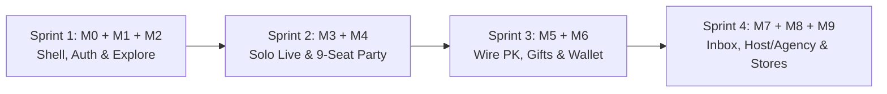

# POPO LIVE — NEXT IMPLEMENTATION PLAN
> **Client Specification Version:** 1.1 (15 November 2026)  
> **Source Document:** Popo Live Client Pack Confidential — Next Implementation Plan  
> **Target:** Complete Android and iOS Clone. Web is built. Phone is next.  
> **Reference Benchmark:** `https://www.poppo.com/home` (Feature parity with public product, Popo Live branding, logo, gift art & copy stay original).

---

## ⚡ SEEDHA MATLAB (Core Directive)

> **Agla kaam phone app hai. Web ke pages dubara mat banao.**  
> **Ek Flutter app: Android aur iOS. Poori access phone pe.**

1. **Web stays thin:** Home, news, policies, LIVE watch, Get Coins (Card top-up), download, and master admin operations.
2. **Phone is the product:** Explore, go-live, party, PK, gifts, chat, wallet, Me.
3. **Same API:** Phone calls the existing Next.js API routes that web already uses (`apps/web/app/api`). **No second backend.**

---

## 📁 Repository State & File Mapping

| Directory / Place | Current Status | Next Implementation Role |
| :--- | :--- | :--- |
| `apps/web` | Marketing site plus live watch, party, PK, gifts, wallet, Square, agency, master admin suite (Phases 1–10). | **Keep. Phone does NOT replace it.** |
| `apps/web/app/api` | ~319 active API route files (Auth, discovery, live, party, gifts, wallet, etc.). | **Phone calls these. No second backend.** |
| `apps/api` | Empty NestJS folder. | **Leave empty for this plan.** |
| `apps/mobile` | 49+ Dart screens in `lib/screens/`. No `pubspec.yaml`, `android/`, `ios/`, or `main.dart`. | **Turn this folder into the runnable Flutter mobile app.** |
| **Existing Mobile Screens** | PK, gifts, wallet, VIP, store, inbox, Square, host, agency, admin companion. | **Wire later in Sprint 3 & 4. DO NOT REWRITE OR DELETE.** |
| **Missing Mobile Screens** | Splash, 18+ gate, login/register, Me, Explore home, go-live studio, viewer room, 9-seat party. | **Created sequentially in Sprint 1 and Sprint 2.** |

---

## 🔄 Complete-Clone Split (Web vs Phone App)

### What the User Gets on Each Surface:
- **Website:** Home, news, about, contact, agency info, 5 legal policies, English/Urdu toggle, app store buttons.
- **Web LIVE:** Watch a stream (already built under `apps/web` live routes).
- **Web Get Coins:** Card top-up (`poppo.com/pay` clone). Stays on web. Phone must NOT use card top-up for digital coins (must comply with Play/Apple billing).
- **Android + iOS:** Full product. Single Flutter codebase. Explore through withdrawal.
- **Admin Panel:** Stays on web (`/admin`). One admin companion screen exists in Flutter; daily operations remain on web.

### Phone Bottom Bar (Locked for the Clone):
```
[ Home ]   [ Party ]   [ Go Live ]   [ Inbox ]   [ Me ]
```
- **Home:** Opens Explore with top tabs: `Follow`, `Explore`, `New`, `PK`. Country chips, banners, rankings, live room cards.
- **Party:** Opens the 9-seat room list, then the room.
- **Go Live:** Runs wealth (Lv.5), face, and cover gates, then opens host studio.
- **Inbox:** Direct messages (1-on-1) plus official system notices.
- **Me:** Holds profile, User ID copy, wallet, VIP, store, daily tasks, agency, withdrawals, and Square posts.

### 🚫 Features Stay OFF Until Signed (Locked Rules):
- ❌ **Lucky / random gifts that return coins** (Anti-gambling compliance).
- ❌ **Paid 1-to-1 video calls** (Screen stays disabled).
- ❌ **Second-level agent commission** (Single-tier agency only).
- ❌ **Near / GPS people tab** (Off by policy).
- ❌ **4-host PK** (1v1 PK is active; 4-host control hidden).
- ❌ **Direct APK downloads** (Official stores only: Google Play Internal/Production, Apple TestFlight/App Store).

---

## 🗓️ 4-Sprint Implementation Order



| Block | Build Target | Done When Criteria |
| :---: | :--- | :--- |
| **M0** | **Flutter App Shell** | `flutter run` opens dark app with 5 bottom tabs on Android/iOS. |
| **M1** | **Login and Me** | New user accepts 18+ gate, signs up, copies User ID, edits profile. |
| **M2** | **Explore Home** | Follow, Explore, New, PK and country chips load real room cards from Next.js API. |
| **M3** | **Solo Live** | One phone goes live. Second phone watches and chats in real time. |
| **M4** | **Party Rooms (9 Seats)** | Host opens 9 seats. Guest requests, host accepts, mic works. |
| **M5** | **PK Battles** | Existing PK screens open from live room. 1v1 score and winner show. |
| **M6** | **Gifts and Wallet** | Existing wallet screens charge Play/Apple coins and send a gift (70% host share). |
| **M7** | **Inbox and Square** | Existing message and post screens sit on Inbox and Me with FCM push. |
| **M8** | **Host and Agency** | Tasks, rankings, agency, seller, withdrawal open from Me by role. |
| **M9** | **Store Release** | Internal Play build and TestFlight build install on real phones. |

---

## 🛠️ Sprint 1 Deep Dive — Immediate Execution

### M0. Open the app without deleting existing screens
> [!CAUTION]
> `apps/mobile/lib/screens/` already holds 49 screens. `flutter create` inside that folder can wipe `lib/`. Create the project scaffold in a temporary folder or carefully copy `android/`, `ios/`, `pubspec.yaml`, `analysis_options.yaml`, and `test/` into `apps/mobile/`. **Leave `lib/screens/` completely untouched.** Add a new `lib/main.dart` beside it.

- **Project Name:** `popo_live`
- **Organization / Bundle ID:** `com.popolive.app`
- **Target Platforms:** Android and iOS only.
- **Theme Tokens (from `docs/DESIGN_SYSTEM.md`):**
  - Primary: `#FF1768`
  - Cyan: `#00E5FF`
  - Gold: `#FFB800`
  - Background: `#0D0D12`
  - Surface: `#161622`
- **Languages:** English and Urdu strings in one dictionary. Default English. Urdu uses Noto font choice.
- **API Client:** Points at the running Next.js origin (`http://localhost:3000` or production VPS `https://kigolive.com`). Auth token in `flutter_secure_storage`. One base URL, no hardcoded demo user in new screens.
- **Bottom Bar:** Home, Party, Go Live, Inbox, Me. (Party, Go Live, and Inbox show a short "Opens in next sprint" placeholder during Sprint 1. Home and Me are fully real).
- **First Dependencies:** `http`, `flutter_secure_storage`. (Agora added in M3, In-App Purchase in M6, Firebase in M7).

#### Files in M0:
- `apps/mobile/pubspec.yaml`
- `apps/mobile/lib/main.dart`
- `apps/mobile/lib/app.dart`
- `apps/mobile/lib/theme/popo_theme.dart`
- `apps/mobile/lib/api/api_client.dart`
- `apps/mobile/lib/shell/app_shell.dart`
- `apps/mobile/lib/l10n/strings.dart`
- `android/` and `ios/` native wrappers

#### M0 is Done When:
- `flutter analyze` has no errors in the new shell files.
- Android emulator / physical device shows the five-tab shell on the dark theme.
- The 49 existing screen files remain untouched on disk.

---

### M1. Login and Me Center
Screens to create with real Next.js API endpoints:

| Screen | Calls / Endpoints | Behavior |
| :--- | :--- | :--- |
| **Splash & 18+ Gate** | Local flag after accept | Blocks app until 18+ terms accepted. |
| **Login** | `POST /api/auth/login` | Email/password or username login. |
| **Register** | `POST /api/auth/register` | New account onboarding. |
| **Phone OTP** | `POST /api/auth/phone/send-otp` & `verify-otp` | Mobile number verification. |
| **Google & Apple** | `GET /api/auth/google` & `apple` | Social sign-in (Apple mandatory for iOS). |
| **Session Restore** | `GET /api/auth/session` | Token restore on app launch. |
| **Complete Profile** | `POST /api/profile/update` | Nickname, birthday, country, gender (Age >= 18). |
| **Me & Edit Profile** | `GET /api/profile/me` & `GET /api/users/{userId}/public-profile` | User ID with copy button, avatar, wealth level. |
| **Settings** | `POST /api/auth/logout` | Language toggle (English/Urdu), session logout. |

#### M1 is Done When:
- A new email user can register, pass age gate, set nickname, and land on Explore.
- Killing the app and reopening it restores the session from secure storage.
- Me screen displays User ID with one-tap copy.
- Logout returns to Login screen and wipes token.
- Invalid password displays API error message.

---

### M2. Explore Home Screen
Replicates the phone screen seen on `poppo.com/home`:
- **Top Tabs:** `Follow`, `Explore`, `New`, `PK`. (No Near tab).
- **Search Icon:** Opens search by host ID, username, room tag using Next.js search API.
- **Trophy Icon:** Opens rankings from `GET /api/discovery/rankings/preview`.
- **Country Chips:** `GET /api/discovery/countries/popular`. First chip is `Popular` (no filter).
- **Banner Row:** `GET /api/discovery/banners` (Honor and Activity banners).
- **Room Grid:** 3:4 aspect ratio cards with host avatar, LIVE badge, viewer count, title, country tag. Pull-to-refresh.
- **Room Tap (until M3):** Opens room preview dialog/screen with host details from `GET /api/discovery/rooms/{roomId}`. (Video playback starts in M3).

#### M2 is Done When:
- Logged-in user sees Follow, Explore, New, and PK with live data from web API.
- Tapping country chips filters the room grid.
- Network error shows retry state; grid never fills with fake data.
- Urdu toggle switches tab labels.

---

## 📋 Antigravity Agent Guidelines for Next Prompts

When developing within this project:
1. **Never attempt to start a NestJS backend in `apps/api`.** The Next.js API in `apps/web/app/api` is the single source of truth.
2. **Never delete or overwrite existing screens in `apps/mobile/lib/screens/`.**
3. **Always follow the Sprint order:** M0 -> M1 -> M2 -> M3 -> M4 -> M5 -> M6 -> M7 -> M8 -> M9.
4. **Do not enable locked-OFF features** (Near/GPS, lucky gifts, paid 1v1 video calls).
5. **Always preserve bilingual English + Urdu support.**
