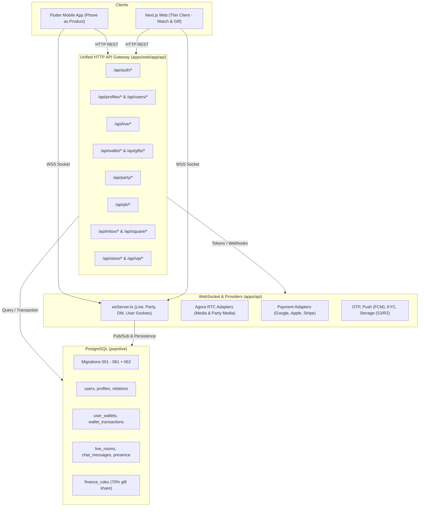

# POPO LIVE BACKEND + REALTIME POSTGRES PLAN
**Document Version:** 1.0 · 22 November 2026 (Post Design Remaining + Completion v1.1)  
**Client Pack:** CONFIDENTIAL  
**Execution Context:** `d:\popo live`  
**Database Schema:** PostgreSQL `popolive` (Single Database)  
**HTTP Gateway:** Next.js Route Tree (`apps/web/app/api`)  
**Real-Time & Adapters:** Node WebSocket & Provider Server (`apps/api`)  

---

## 1. Core Philosophy ("Seedha Matlab")

1. **Design Miss Closure (B0):** Pehle jo design reh gaya hai, usko band karo. Wire the four people lists to `UserRelationListScreen` and freeze all module & provider flags to `false`.
2. **One Database (PostgreSQL):** Phir har screen fixture se hata kar Postgres API pe lao. No local mock databases, no SQLite.
3. **Single HTTP Server:** Naya NestJS HTTP server mat banao. Phone and Web dono `apps/web/app/api` call karein.
4. **WebSocket Gateway:** Real-time socket events `apps/api` (`wsServer.ts`) se handle honge.
5. **Fail-Fast Discipline:** Fail hua to error dikhao, fake success nahi. No empty `catch` blocks that silently fall back to `DesignFixtures` or return fake zeros.
6. **Web-App Split:** Public web stays thin (watch stream & send gifts). Camera Go Live and 9-seat take stay on the mobile phone sheet.

---

## 2. Locked Product Rules

| Rule | Database Location | Strict Behavioral Requirement |
| :--- | :--- | :--- |
| **Host Gift Share 70%** | `finance_rules.host_gift_share_percent` | Gift coins credit host points at exactly 70%. Never hardcode a secondary rate in UI. |
| **Wealth Level 5 to Go Live** | `users.wealth_level` + `go_live_eligible` | Studio gate refuses broadcast start below level 5 unless staff or `go_live_eligible`. |
| **Age 18 Adult Gate** | `is_adult_verified` / `birthdate` | Registration, OTP, Streamer Center, and Builder Center refuse users under 18. |
| **9 Party Seats** | `party_seats` | Exactly 9 seats (seats 1–9). Seat tap on desktop web opens phone redirect sheet. |
| **1v1 PK Only** | `pk_battles` | 4-Host battle remains unlabeled, unclickable, and unreachable on phone and web. |
| **Strictly Disabled** | Feature Flags | Near/GPS, paid 1-on-1 video call, lucky gifts, direct APK installer, Huawei button. |

---

## 3. Flag Discipline & Configuration Architecture

### A. Module Flags (Must be `false` in B0; enabled one-by-one per phase)
- **Mobile (`apps/mobile/lib/api/api_config.dart`):**
  - `USE_LIVE_API = bool.fromEnvironment('USE_LIVE_API', defaultValue: false)`
  - `USE_PARTY_API = bool.fromEnvironment('USE_PARTY_API', defaultValue: false)`
  - `USE_MESSAGE_API = bool.fromEnvironment('USE_MESSAGE_API', defaultValue: false)`
  - `USE_ECONOMY_API = bool.fromEnvironment('USE_ECONOMY_API', defaultValue: false)`
  - `USE_VIP_API = bool.fromEnvironment('USE_VIP_API', defaultValue: false)`
  - `USE_STORE_API = bool.fromEnvironment('USE_STORE_API', defaultValue: false)`
  - `USE_COMMUNITY_API = bool.fromEnvironment('USE_COMMUNITY_API', defaultValue: false)`
  - `USE_FINAL_API = bool.fromEnvironment('USE_FINAL_API', defaultValue: false)`
- **Web (`apps/web/lib/clientFlags.ts` & `.env.*`):**
  - `NEXT_PUBLIC_USE_LIVE_API=false`
  - `NEXT_PUBLIC_USE_PARTY_API=false`
  - `NEXT_PUBLIC_USE_MESSAGE_API=false`
  - `NEXT_PUBLIC_USE_ECONOMY_API=false`
  - `NEXT_PUBLIC_USE_VIP_API=false`
  - `NEXT_PUBLIC_USE_STORE_API=false`
  - `NEXT_PUBLIC_USE_COMMUNITY_API=false`
  - `NEXT_PUBLIC_USE_FINAL_API=false`

### B. Real-Provider Flags (Must remain `false` until Phase B11)
- `USE_REAL_OTP` (SMS / Email verification)
- `USE_REAL_MEDIA` & `USE_REAL_PARTY_MEDIA` (Agora RTC audio/video)
- `USE_REAL_WEBSOCKET` (`apps/api` socket server)
- `USE_REAL_PAYMENTS` (Google Play Billing, App Store StoreKit, Card webhooks)
- `USE_REAL_PUSH` (Firebase Cloud Messaging)
- `USE_REAL_KYC` & `USE_REAL_PAYOUT` (Host ID verification & withdrawal processor)
- `USE_REAL_STORAGE` (S3 / Cloudflare R2 image upload)
- `USE_REAL_ADMIN` (Restricted staff desk access)

> [!IMPORTANT]
> **Done When Flag Is ON:** Once a module flag is enabled, that module **never** reads `DesignFixtures` for its primary data. Empty from SQL means empty list on screen; error from SQL must propagate and display an error state. Never mask a database failure with fixture data.

---

## 4. Phase-by-Phase Implementation Sequence

```mermaid
flowchart LR
    B0["B0: Close Design & Freeze Flags"] --> B1["B1: PostgreSQL Foundation"]
    B1 --> B2["B2: Auth & Session"]
    B2 --> B3["B3: Profile & 4 People Lists"]
    B3 --> B4["B4: Live Discovery & Chat"]
    B4 --> B5["B5: Coins, Points & Gift Ledger"]
    B5 --> B6["B6: Party Rooms 9-Seats"]
    B6 --> B7["B7: PK Battle 1v1"]
    B7 --> B8["B8: Message & Square"]
    B8 --> B9["B9: VIP, Store, Bag, Redeem"]
    B9 --> B10["B10: Community & Center Hubs"]
    B10 --> B11["B11: Real-time Sockets & Providers"]
    B11 --> B12["B12: Web Split & Production Ship"]
```

### Phase B0: Close the Last Design Door & Freeze Flags
- **Scope:**
  - In `apps/mobile/lib/screens/profile/me_screen.dart`, replace `_showCountPreview` with `Navigator.push` to `UserRelationListScreen` for Friends, Following, Followers, and Visitors.
  - Eliminate the obsolete `"Detailed list module will be available in Phase D5."` sentence completely.
  - Freeze all mobile and web module flags to `false`.
  - Remove silent fixture fallbacks in `LiveApiService` and twin services when flags are enabled.
- **Done When:** Four people counts open full rows on mobile. All module flags are OFF. Forced API failure when flag is on renders error state.

### Phase B1: PostgreSQL Foundation & Missing Tables
- **Scope:**
  - Execute migrations `001` through `061` against local PostgreSQL (`popolive` schema).
  - Add **Migration 062** for missing relations: `user_friends` (or mutual-follow view), `profile_visits`, `guardians`, `user_medals` / `medal_catalog`, `redeem_codes` + `redeem_redemptions`, `live_room_history`, and `user_invite_codes`.
  - Seed `finance_rules.host_gift_share_percent = 70`. Seed canonical coin packages, VIP tiers, and store categories.
  - Implement a single-command migration runner (`npm run db:migrate`) that fails deployment if any required table is missing.
- **Done When:** Local DB contains schema `popolive`, migration 062 is applied, and `finance_rules` returns 70%.

### Phase B2: Authentication & Session on Database
- **Scope:**
  - Register, Login, Phone OTP, Session Restore, and Logout using `popolive.users`, `sessions`, and `otp_verifications`.
  - Fixture fast login remains strictly local while `USE_FINAL_API` is false; real user login operates on DB.
  - Enforce age 18 verification (`is_adult_verified = true`). Users under 18 cannot access Go Live or Builder Center.
- **Done When:** Registration, login, app restart session restore, and logout succeed on SQL. Wrong credentials display visible API error.

### Phase B3: Profile & The Four People Lists
- **Scope:**
  - Connect `GET/PATCH /api/profiles/me` and public profiles to SQL.
  - Implement endpoints `/api/users/[userId]/friends`, `/following`, `/followers`, `/visitors`.
  - Friends = bidirectional mutual follows. Visitors = `profile_visits` records inserted on profile view.
- **Done When:** Me counts and all four list views read real database records. Follow/unfollow persists in SQL.

### Phase B4: Live Discovery, Viewer & Chat
- **Scope:**
  - Turn on `USE_LIVE_API`. Explore, Live Now, Following feeds read PostgreSQL room records.
  - Viewer join records presence. Chat persists to `live_room_chat_messages`.
  - Viewer counter displays SQL presence count. Empty country filter returns clean empty state.
- **Done When:** Web viewer and mobile phone see the same live room from PostgreSQL. Chat persists across refresh.

### Phase B5: Coins, Points & Gift Ledger
- **Scope:**
  - Turn on `USE_ECONOMY_API`. Read `user_wallets` and `wallet_transactions`.
  - Atomic gift transaction: Sender coins deducted, host points credited at exactly 70% in one database transaction.
  - Insufficient balance returns typed error without deducting coins.
- **Done When:** Gift send decrements coin balance, increments host points by 70%, and writes transaction ledger rows.

### Phase B6: Party Rooms & Nine Seats
- **Scope:**
  - Turn on `USE_PARTY_API`. 9-seat audio lounges, seat requests, host approvals, and mic states persist in SQL.
  - Desktop web seat tap opens `GoLiveRedirectSheet`.
- **Done When:** Create 9-seat room, request seat, approve seat, and see seat avatar update after refresh.

### Phase B7: PK Battles (1v1 Only)
- **Scope:**
  - 1v1 battle invites, scores, timers, and gift contributions persist in SQL.
  - 4-Host battle remains unlabeled, unclickable, and unreachable.
- **Done When:** Two hosts execute a 1v1 PK battle to conclusion with final stored results.

### Phase B8: Message & Community Square
- **Scope:**
  - Turn on `USE_MESSAGE_API`. 1-on-1 direct messages, conversation threads, and official notices persist.
  - Square feed posts, comments, likes, and image URLs persist to `square_*` tables.
- **Done When:** DMs and Square posts survive application restarts and appear in correct chronological order.

### Phase B9: VIP, Store, Bag & Voucher Redeem
- **Scope:**
  - Turn on `USE_VIP_API` and `USE_STORE_API`. VIP plans, store purchases, inventory equips, and voucher redemption hit SQL.
  - Invalid voucher code returns typed error response from API.
- **Done When:** User purchases store item, equips it in Bag, and redeems vouchers with ledger balance updates.

### Phase B10: Community Modules, Center Hubs & Help
- **Scope:**
  - Turn on `USE_COMMUNITY_API` and `USE_FINAL_API`.
  - Wire Fan Club, Guardian, Medals, Streamer Center tasks, Builder Center agency operations, Help Center tickets, and Settings block list.
- **Done When:** Every Me screen door that previously passed on fixtures passes against PostgreSQL with matching layouts.

### Phase B11: Real-Time WebSockets & Production Providers
- **Scope:**
  - Activate `apps/api` WebSocket server with token authentication.
  - Turn on `USE_REAL_WEBSOCKET`. Replace polling with socket events (chat, gifts, seats).
  - Sequentially enable real providers: Agora RTC (`USE_REAL_MEDIA`, `USE_REAL_PARTY_MEDIA`), Payments (`USE_REAL_PAYMENTS`), SMS OTP (`USE_REAL_OTP`), Push (`USE_REAL_PUSH`), Storage (`USE_REAL_STORAGE`), KYC & Payout (`USE_REAL_KYC`, `USE_REAL_PAYOUT`).
- **Done When:** Two independent devices receive chat, gifts, and party seat updates in real time without refreshing.

### Phase B12: Web Split, Admin Desk & Production Cutover
- **Scope:**
  - Enforce thin web boundaries. Separate Admin desk requiring `isStaffMember = true` and `USE_REAL_ADMIN = true`.
  - Apply migrations 001–062 on staging and production PostgreSQL with SSL.
  - Purge reference demo names from public routes.
- **Done When:** Staging proof walk passes with zero fixture flags. Production database is migrated and healthy.

---

## 5. The 12 Mandatory Proof Walks

| # | Walk Name | Verification Criteria | Done Indicator |
|---|---|---|:---:|
| **1** | **B0 Design & Flags** | 4 phone lists open `UserRelationListScreen`. All flags OFF. No silent fallback on forced failure. | PASS |
| **2** | **DB Migration Foundation** | Migrations 001–062 applied. `finance_rules` returns 70%. Migrate runner fails if table missing. | PENDING |
| **3** | **Auth & Age Gate** | Registration, login, age 18 check, session restore, logout against SQL. | PENDING |
| **4** | **People & Social** | Friends, following, followers, visitors from SQL. Follow toggle persists in DB. | PENDING |
| **5** | **Live Stream & Chat** | Live rooms and room chat messages read/write PostgreSQL on mobile & web. | PENDING |
| **6** | **Gift Ledger** | Atomic transaction: sender coins drop, host points +70%, ledger history records created. | PENDING |
| **7** | **Party & 1v1 PK** | 9-seat lounge management persists. 1v1 PK battle completes. 4-host unreachable. | PENDING |
| **8** | **Message & Square** | Direct messages and Square posts/comments survive full server restart. | PENDING |
| **9** | **Shop & Redeem** | VIP subscription, store purchase, bag equip, and voucher redemption hit SQL. | PENDING |
| **10** | **Me Centers & Hubs** | Streamer Center, Builder Center, Help, and Settings persist to database. | PENDING |
| **11** | **Real-Time Sockets** | Live chat, gift animations, and party seat changes arrive via WebSocket without refresh. | PENDING |
| **12** | **Providers & Ship** | Agora RTC, real payments, OTP, and push verified in staging. Production cutover clean. | PENDING |

---

## 6. Out of Plan (Strictly Prohibited)

- ❌ Near / GPS location tracking.
- ❌ Paid 1-to-1 video calls.
- ❌ Lucky gift wheel / gambling mechanics.
- ❌ Direct APK auto-downloader or Huawei AppGallery buttons.
- ❌ Launching 4-Host PK battle mode.
- ❌ Copying competitor host names, avatars, logos, or prize artwork.
- ❌ Creating a duplicate NestJS HTTP backend (All HTTP APIs reside in `apps/web/app/api`).
